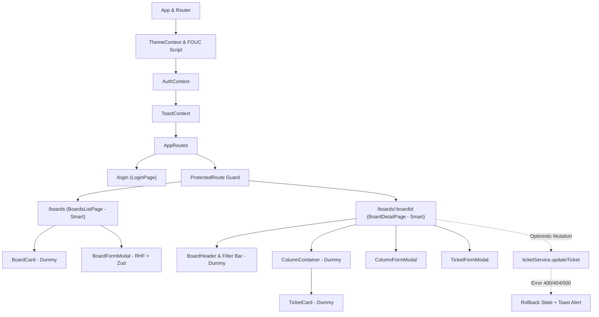

# Plan de Implementación Frontend — DevBoard (Kanban SPA)

Este documento técnico establece la hoja de ruta de implementación estructurada por fases para el desarrollo del frontend de **DevBoard**, conforme a la especificación de requerimientos de [Frontend.md](file:///c:/Users/santi/Documents/Proyectos-Kanban/Frontend.md) y en estricta sincronía con la API REST existente en [Grupo-F---proyecto-Kanban](file:///c:/Users/santi/Documents/Proyectos-Kanban/Grupo-F---proyecto-Kanban).

---

## 1. Goal Description

Construir una Single Page Application (SPA) modular, robusta y visualmente distintiva en **React 18+ y Vite** bajo la metodología **Desarrollo Basado en Especificaciones (SDD)**. La aplicación implementará:
- Separación estricta entre **Componentes Contenedores (Smart/Views)** y **Componentes Presentacionales (Dummy/Atómicos)**.
- Sistema de diseño **Silicon Valley Retro-Tech** con soporte nativo de variables CSS para **Light Mode** y **Dark Mode**, detección de preferencias de sistema y prevención de parpadeo de estilos (FOUC).
- Control de concurrencia y **Optimistic UI** con rollback automático y notificaciones toast ante fallos en el movimiento de tickets.
- Formularios controlados con **React Hook Form + Zod**, mapeo de errores del backend (`400 Bad Request`) directo en inputs sin recargas y estados de carga visibles.
- Integración completa con los 15 endpoints jerárquicos del backend (`Board -> Column -> Ticket`).

---

## 2. User Review Required

> [!IMPORTANT]
> **Estructura del Proyecto y Ubicación de la Carpeta Frontend**
> El repositorio del backend se encuentra en `Grupo-F---proyecto-Kanban`. Se propone crear la aplicación frontend en un directorio dedicado `frontend/` dentro de `c:\Users\santi\Documents\Proyectos-Kanban\frontend` (o `devboard-frontend/`), manteniendo ambos proyectos desacoplados e independientes.

> [!IMPORTANT]
> **Estrategia de Autenticación y Ruta `/login`**
> La especificación [Frontend.md](file:///c:/Users/santi/Documents/Proyectos-Kanban/Frontend.md) define la ruta pública `/login` y rutas protegidas `/boards` y `/boards/:boardId`. Sin embargo, el backend actual no expone endpoints de autenticación (`/api/auth`).
> **Solución propuesta:** Implementar un `AuthContext` con autenticación simulada (almacenamiento de sesión/token en `localStorage` con usuarios demo) listo para ser conectado a endpoints JWT reales tan pronto como el backend los exponga.

> [!NOTE]
> **Interacción de Arrastre de Tickets (Drag & Drop)**
> Para el movimiento entre columnas con actualización optimista, utilizaremos HTML5 Drag & Drop nativo con estados visuales claros o `@hello-pangea/dnd` (fork moderno y mantenido de react-beautiful-dnd, 100% compatible con React 18).

---

## 3. Open Questions

> [!NOTE]
> **Formato de Identificadores Monoespaciados para Tickets**
> El backend utiliza ObjectIds de MongoDB de 24 caracteres (ej. `67b60e...`). Para cumplir la regla de "identificadores monoespaciados tipo `TICKET-104` o `#42`", se formateará una etiqueta visual calculada a partir de los últimos 6 caracteres hexadecimales en mayúsculas (ej. `#TK-3F8A1B`) o mediante un contador local indexado.

---

## 4. Arquitectura y Modelo de Datos

### Diagrama de Flujo y Jerarquía de Componentes



### Paleta Semántica: Silicon Valley Retro-Tech

```css
/* Light Mode (Crema Cálido / Solarized Light) */
:root {
  --bg-primary: #FDF6E3;
  --bg-card: #EEE8D5;
  --text-primary: #073642;
  --accent-color: #CB4B16;
  --font-mono: 'JetBrains Mono', 'Fira Code', monospace;
}

/* Dark Mode (Petróleo Retro / Solarized Dark) */
html.dark,
body.dark {
  --bg-primary: #002B36;
  --bg-card: #073642;
  --text-primary: #839496;
  --accent-color: #2AA198;
}
```

---

## 5. Fases de Implementación (Partición Generativa SDD)

```mermaid
gantt
    title Cronograma de Implementación Frontend
    dateFormat  X
    axisFormat %d
    section Fase 0: Setup
    Vite + Tailwind + Design System :0, 1
    section Fase 1: API
    HTTP Client + Services + Mocks :1, 2
    section Fase 2: Contexts
    Theme + Auth + Toast :2, 3
    section Fase 3: Atómicos
    Biblioteca UI Dummy :3, 4
    section Fase 4: Features
    Modales RHF + Zod + Cards :4, 5
    section Fase 5: Vistas
    Pages + Routing + Optimistic UI :5, 6
    section Fase 6: QA
    Verificación E2E + README :6, 7
```



---

### Fase 0: Configuración del Entorno, Dependencias y Sistema de Diseño

#### Objetivos
1. Inicializar el proyecto con Vite y React 18+.
2. Instalar el conjunto estricto de dependencias de producción y desarrollo:
   - `react-router-dom`: Enrutamiento declarativo.
   - `axios`: Cliente HTTP para consumir los endpoints REST.
   - `react-hook-form` + `@hookform/resolvers` + `zod`: Manejo y validación declarativa de formularios.
   - `lucide-react`: Iconografía técnica y minimalista.
   - `@hello-pangea/dnd`: Drag and drop accesible para columnas y tickets.
   - `tailwindcss`, `postcss`, `autoprefixer`: Estilizado configurado sobre las variables nativas.
3. Configurar tipografías de Google Fonts en `index.html` (**JetBrains Mono** para tickets/métricas y sans-serif moderna para interfaces).
4. Implementar el script síncrono inline anti-FOUC en `index.html` para lectura inmediata de `localStorage.getItem('theme')` y `matchMedia`.
5. Crear `src/index.css` con los tokens semánticos globales `:root` y `.dark`.
6. Configurar variables de entorno: `.env` y `.env.example` con `VITE_API_URL=http://localhost:5000/api`.

#### Estructura de Archivos a Crear
- [NEW] `frontend/index.html`
- [NEW] `frontend/vite.config.js`
- [NEW] `frontend/package.json`
- [NEW] `frontend/tailwind.config.js`
- [NEW] `frontend/.env.example`
- [NEW] `frontend/.env`
- [NEW] `frontend/src/index.css`

---

### Fase 1: Capa de Servicios API, Cliente HTTP y Datos Sintéticos (`src/api`)

#### Objetivos
Centralizar todas las llamadas de red y contratos HTTP, aislando completamente las vistas de `fetch` o `axios` directos:
1. **Cliente Centralizado (`src/api/client.js`)**:
   - Lectura de `import.meta.env.VITE_API_URL`.
   - Interceptores para inyectar token de autorización si está presente.
   - Normalización de errores para extraer `{ error: error.response?.data?.error || 'Mensaje' }`.
2. **Servicio de Tableros (`src/api/boardService.js`)**:
   - `getAllBoards()`: `GET /api/boards`
   - `getBoardById(boardId)`: `GET /api/boards/:boardId`
   - `createBoard(payload)`: `POST /api/boards`
   - `updateBoard(boardId, payload)`: `PATCH /api/boards/:boardId`
   - `deleteBoard(boardId)`: `DELETE /api/boards/:boardId`
3. **Servicio de Columnas (`src/api/columnService.js`)**:
   - `getColumns(boardId)`: `GET /api/boards/:boardId/columns`
   - `createColumn(boardId, payload)`: `POST /api/boards/:boardId/columns`
   - `updateColumn(boardId, columnId, payload)`: `PATCH /api/boards/:boardId/columns/:columnId`
   - `deleteColumn(boardId, columnId)`: `DELETE /api/boards/:boardId/columns/:columnId`
4. **Servicio de Tickets (`src/api/ticketService.js`)**:
   - `getTickets(boardId, columnId)`: `GET /api/boards/:boardId/columns/:columnId/tickets`
   - `createTicket(boardId, columnId, payload)`: `POST /api/boards/:boardId/columns/:columnId/tickets`
   - `updateTicket(boardId, columnId, ticketId, payload)`: `PATCH /api/boards/:boardId/columns/:columnId/tickets/:ticketId` (soporta `targetColumnId`, `title`, `description`, `priority`, `order`)
   - `deleteTicket(boardId, columnId, ticketId)`: `DELETE /api/boards/:boardId/columns/:columnId/tickets/:ticketId`
5. **Módulo de Mocks y Fallback (`src/api/mockData.js`)**:
   - Datos sintéticos espejo de `seed.js` del backend para pruebas sin base de datos activa.

#### Estructura de Archivos a Crear
- [NEW] `frontend/src/api/client.js`
- [NEW] `frontend/src/api/boardService.js`
- [NEW] `frontend/src/api/columnService.js`
- [NEW] `frontend/src/api/ticketService.js`
- [NEW] `frontend/src/api/mockData.js`

---

### Fase 2: Contextos Globales y Custom Hooks (`src/hooks`)

#### Objetivos
1. **Gestión de Tema (`ThemeContext` & `useTheme`)**:
   - Control del modo `light` / `dark`.
   - Persistencia en `localStorage`.
   - Sincronización con la clase `.dark` en `document.documentElement`.
2. **Gestión de Sesión (`AuthContext` & `useAuth`)**:
   - Proveer estado `user`, `token`, `isAuthenticated`, `login(credentials)` y `logout()`.
   - Persistencia en `localStorage` para sobrevivir a recargas.
3. **Sistema de Notificaciones (`ToastContext` & `useToast`)**:
   - Soporte para notificaciones `success`, `error`, `info`.
   - Componente visual retro para mensajes flotantes indispensables para el rollback de Optimistic UI.

#### Estructura de Archivos a Crear
- [NEW] `frontend/src/hooks/useTheme.jsx`
- [NEW] `frontend/src/hooks/useAuth.jsx`
- [NEW] `frontend/src/hooks/useToast.jsx`

---

### Fase 3: Componentes Presentacionales Atómicos de UI (`src/components`)

#### Objetivos
Crear la biblioteca de componentes atómicos puros (dummy). **Restricción estricta:** Tienen prohibido utilizar `useEffect` o realizar llamadas a la red; reciben solo `props` y emiten eventos:
1. `Button.jsx`: Botón estilizado con soporte para variantes (`primary`, `secondary`, `danger`, `ghost`), estado `isSubmitting` / `disabled` y spinner retro.
2. `Input.jsx` & `Textarea.jsx`: Controles de formulario compatibles con `React Hook Form` (reenvío de `ref`), con visualización inline de errores de validación.
3. `Select.jsx`: Dropdown estilizado para selección de prioridad (`low`, `medium`, `high`) o columnas de destino.
4. `Badge.jsx`: Indicadores visuales de prioridad con colores retro distintivos.
5. `Modal.jsx`: Contenedor modal con backdrop difuminado, soporte para tecla `Escape` y accesibilidad.
6. `ConfirmDialog.jsx`: Modal de confirmación para borrados destructivos (advirtiendo el borrado en cascada de columnas y tickets).
7. `Spinner.jsx`: Animación de carga minimalista.
8. `ToastContainer.jsx`: Contenedor flotante de alertas.
9. `Navbar.jsx`: Barra de navegación con logo, selector de tema (ThemeToggle), estado de usuario y botón de cerrar sesión.

#### Estructura de Archivos a Crear
- [NEW] `frontend/src/components/Button.jsx`
- [NEW] `frontend/src/components/Input.jsx`
- [NEW] `frontend/src/components/Textarea.jsx`
- [NEW] `frontend/src/components/Select.jsx`
- [NEW] `frontend/src/components/Badge.jsx`
- [NEW] `frontend/src/components/Modal.jsx`
- [NEW] `frontend/src/components/ConfirmDialog.jsx`
- [NEW] `frontend/src/components/Spinner.jsx`
- [NEW] `frontend/src/components/ToastContainer.jsx`
- [NEW] `frontend/src/components/Navbar.jsx`

---

### Fase 4: Módulos de Dominio y Formularios Validados (`src/features`)

#### Objetivos
1. **Esquemas Zod de Validación (`src/features/.../schemas.js`)**:
   - Tablero: `title` obligatorio (máx 120 car.), `description` opcional (máx 500 car.).
   - Columna: `title` obligatorio (máx 80 car.).
   - Ticket: `title` obligatorio (máx 150 car.), `description` opcional (máx 2000 car.), `priority` enum (`low`, `medium`, `high`).
2. **Componentes de Tarjetas Presentacionales**:
   - `TicketCard.jsx`: Renderiza código monoespaciado (`#TK-XXXX`), título, badge de prioridad, botón de editar, botón de eliminar. Sin `useEffect`.
   - `ColumnContainer.jsx`: Renderiza cabecera de columna, contador de tickets `[N]`, botón para agregar ticket, opciones de columna y lista de tickets.
   - `BoardCard.jsx`: Tarjeta de resumen de tablero para la lista general con conteo de columnas.
3. **Modales de Creación y Edición con RHF + Zod**:
   - `BoardFormModal.jsx`: Formulario controlado con `useForm` y `zodResolver`. Manejo de `isSubmitting` y captura de `setError` ante respuesta 400 del backend.
   - `ColumnFormModal.jsx`: Modal para añadir o renombrar columnas.
   - `TicketFormModal.jsx`: Modal completo para creación/edición de tickets con selección de prioridad.

#### Estructura de Archivos a Crear
- [NEW] `frontend/src/features/boards/BoardCard.jsx`
- [NEW] `frontend/src/features/boards/BoardFormModal.jsx`
- [NEW] `frontend/src/features/boards/boardSchema.js`
- [NEW] `frontend/src/features/columns/ColumnContainer.jsx`
- [NEW] `frontend/src/features/columns/ColumnFormModal.jsx`
- [NEW] `frontend/src/features/columns/columnSchema.js`
- [NEW] `frontend/src/features/tickets/TicketCard.jsx`
- [NEW] `frontend/src/features/tickets/TicketFormModal.jsx`
- [NEW] `frontend/src/features/tickets/ticketSchema.js`

---

### Fase 5: Vistas Principales, Enrutamiento SPA y Optimistic UI (`src/pages` / `src/routes`)

#### Objetivos
1. **Enrutador y Guardias (`src/routes`)**:
   - Configuración de `BrowserRouter` con matriz de rutas:
     - `/login` $\rightarrow$ `LoginPage` (pública)
     - `/boards` $\rightarrow$ `BoardsListPage` (protegida con `ProtectedRoute`)
     - `/boards/:boardId` $\rightarrow$ `BoardDetailPage` (protegida con `ProtectedRoute`)
     - `*` $\rightarrow$ Redirección a `/boards` o `NotFoundPage`.
2. **Vista de Login (`src/pages/LoginPage.jsx`)**:
   - Formulario de autenticación con RHF + Zod.
   - Redirección programática con `useNavigate('/boards')` únicamente tras validación exitosa.
3. **Vista de Listado de Tableros (`src/pages/BoardsListPage.jsx`)**:
   - Carga inicial mediante `boardService.getAllBoards()`.
   - Manejo de estados: `isLoading`, `error` (con botón de reintentar), `boards` vacíos o poblados.
   - Creación de nuevo tablero y navegación al nuevo tablero tras recibir respuesta exitosa `201 Created`.
4. **Vista Detalle Kanban (`src/pages/BoardDetailPage.jsx`)**:
   - Extracción de `:boardId` mediante `useParams()`.
   - Carga del tablero completo con columnas y tickets poblados (`boardService.getBoardById`).
   - Orquestación de mutaciones (Creación de columnas y tickets con petición estándar y spinner).
   - **Algoritmo de Optimistic UI con Rollback**:
     ```javascript
     const handleMoveTicket = async (ticketId, sourceColId, targetColId, newOrder) => {
       // 1. Guardar copia de seguridad del estado
       const previousBoard = structuredClone(board);

       // 2. Aplicar mutación optimista local inmediatamente
       setBoard(currentBoard => {
         const next = structuredClone(currentBoard);
         const sourceCol = next.columns.find(c => c._id === sourceColId);
         const targetCol = next.columns.find(c => c._id === targetColId);
         const ticketIndex = sourceCol.tickets.findIndex(t => t._id === ticketId);
         const [ticket] = sourceCol.tickets.splice(ticketIndex, 1);
         ticket.columnId = targetColId;
         ticket.order = newOrder;
         targetCol.tickets.splice(newOrder, 0, ticket);
         return next;
       });

       try {
         // 3. Ejecutar petición al backend
         await ticketService.updateTicket(board._id, sourceColId, ticketId, {
           targetColumnId: targetColId,
           order: newOrder
         });
       } catch (error) {
         // 4. Rollback al estado previo si el servidor responde con 400, 404 o 500
         setBoard(previousBoard);
         toast.error(error.response?.data?.error || 'Error al mover el ticket. Operación revertida.');
       }
     };
     ```

#### Estructura de Archivos a Crear
- [NEW] `frontend/src/routes/AppRoutes.jsx`
- [NEW] `frontend/src/routes/ProtectedRoute.jsx`
- [NEW] `frontend/src/pages/LoginPage.jsx`
- [NEW] `frontend/src/pages/BoardsListPage.jsx`
- [NEW] `frontend/src/pages/BoardDetailPage.jsx`
- [NEW] `frontend/src/pages/NotFoundPage.jsx`
- [NEW] `frontend/src/App.jsx`
- [NEW] `frontend/src/main.jsx`

---

### Fase 6: Pruebas, Validación Integral y Documentación Técnica

#### Objetivos
1. **Verificación de Flujos de Usuario**:
   - Navegación pública/protegida sin bucles infinitos.
   - Creación, edición y borrado de tableros, columnas y tickets.
   - Verificación de la advertencia de borrado en cascada.
2. **Validación de Optimistic UI y Rollback**:
   - Mover ticket en condiciones normales $\rightarrow$ confirmación fluida.
   - Simular fallo (ej. desconectar backend o simular endpoint erróneo) $\rightarrow$ verificar que el ticket regresa de inmediato a su columna original y se despliega el Toast con el mensaje de error.
3. **Validación Visual y Accesibilidad**:
   - Alternancia instantánea entre Light Mode y Dark Mode con persistencia en `localStorage`.
   - Recarga de página con inspección de cero parpadeo (FOUC).
   - Tipografía monoespaciada en identificadores de tickets y badges.
4. **Documentación Técnica (`README.md` del Frontend)**:
   - Descripción del proyecto, justificación de arquitectura SDD y separación Contenedor/Presentacional.
   - Tabla de tecnologías y librerías.
   - Guía paso a paso para instalación, configuración de `.env`, ejecución con backend y con mocks.

#### Estructura de Archivos a Crear
- [NEW] `frontend/README.md`

---

## 6. Verification Plan

### Automated Tests
1. **Compilación y Build de Producción**:
   ```powershell
   cd c:\Users\santi\Documents\Proyectos-Kanban\frontend
   npm run build
   ```
2. **Linting y Verificación de Código**:
   ```powershell
   npm run lint
   ```

### Manual Verification
1. **Flujo de Autenticación y Guardias**:
   - Intentar acceder directamente a `/boards` $\rightarrow$ Redirección inmediata a `/login`.
   - Ingresar credenciales en `/login` $\rightarrow$ Validación Zod, inicio de sesión y navegación automática a `/boards`.
2. **Gestión de Tableros y Cascada**:
   - Crear un tablero "Sprint Alpha" con descripción.
   - Ingresar a `/boards/:boardId` y crear 3 columnas ("Por hacer", "En progreso", "Listo").
   - Agregar 2 tickets con distintas prioridades en "Por hacer".
   - Eliminar una columna con tickets $\rightarrow$ Confirmar advertencia de cascada y verificar desaparición limpia.
3. **Optimistic UI con Rollback**:
   - Arrastrar un ticket de "Por hacer" a "En progreso" con backend activo $\rightarrow$ Movimiento suave y persistido.
   - Detener temporalmente el servidor backend o ingresar un ID inválido $\rightarrow$ El ticket debe volver a "Por hacer" y debe aparecer el Toast: `"Error al mover el ticket..."`.
4. **Theme Switch & Anti-FOUC**:
   - Alternar a Dark Mode $\rightarrow$ Fondo cambia a petróleo retro (`#002B36`).
   - Refrescar la página (`F5`) $\rightarrow$ La interfaz debe cargar directamente en Dark Mode sin transición ni parpadeo blanco.
5. **Manejo de Errores de Validación**:
   - Enviar formulario de ticket sin título $\rightarrow$ Ver mensaje de error en rojo bajo el input sin recargar la página.
